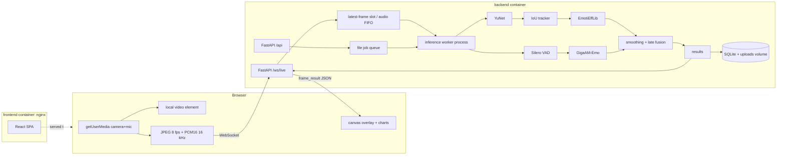
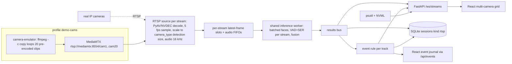
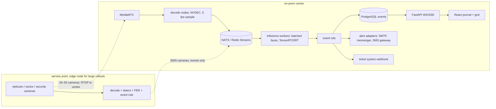

# Architecture diagrams

## MVP (one laptop, Docker)

## Multi-camera RTSP and events (CAP-10, CAP-11, built in MVP)

## Target for 30–50 cameras and outlook to 3000 (CAP-9, not built in MVP)

The MVP's `source → queue → worker → results` interfaces map one-to-one onto this picture. At 30–50 cameras video goes to the centre. At 3000, bandwidth rules that out, so sites run edge nodes and send only events.
