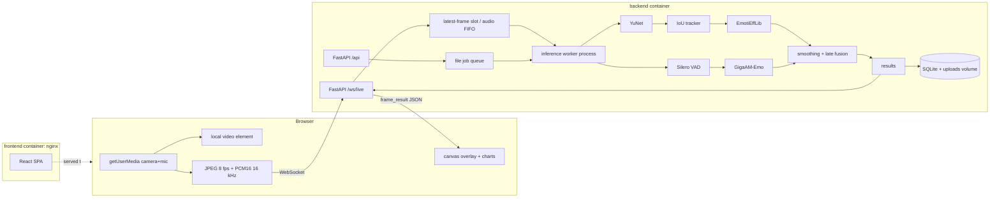
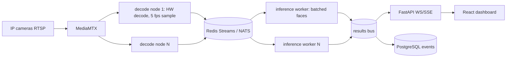

# Architecture diagrams

## MVP (one laptop, Docker)

## Seam for scaling (CAP-9 target, not built in MVP)

The MVP's `source → queue → worker → results` interfaces map one-to-one onto this picture. In the MVP the browser WebSocket is the only source adapter.
